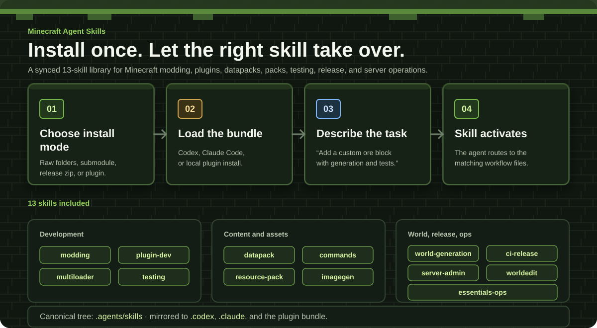

# Minecraft Agent Skills

13 skills for Minecraft mods, plugins, datapacks, art, and server administration.
Supports Minecraft 26.x, with examples for 1.21.x and Forge 1.20.1.
Use the skill folders directly or install the Codex or Claude Code plugin.

## Install

Install one copy of each skill for the host you use. Preserve unrelated local
skills when a target already exists. Copy only the selected skill folders if
you do not need the whole bundle; do not copy this repository's `AGENTS.md`
into a Minecraft project.

| Host | Copy or install |
| --- | --- |
| Codex | `.agents/skills/` into the project's `.agents/skills/` |
| Older Codex hosts | `.codex/skills/` only if that host uses the legacy location |
| Claude Code | `.claude/skills/` into the project's `.claude/skills/` |
| Plugin | `.agents/plugins/marketplace.json` and `plugins/minecraft-codex-skills/` |

For a Codex plugin install, keep the marketplace file and plugin directory under
the same project root, open the plugins surface, and install
`minecraft-codex-skills`. For Claude Code, run:

```bash
claude --plugin-dir ./plugins/minecraft-codex-skills
```

The raw folders and plugin are alternative installation methods. Loading both
can expose duplicate skills. `minecraft-imagegen` needs an image-generation
tool supplied by the host or an already connected integration; installing this
bundle or selecting a model does not add that tool.

<!-- markdownlint-disable MD033 -->
<p align="center">
  
</p>
<!-- markdownlint-enable MD033 -->

## Skills

| Skill | Use it for |
| --- | --- |
| `minecraft-modding` | NeoForge, Fabric, and Forge 1.20.1 mods |
| `minecraft-plugin-dev` | Paper, Bukkit, and Spigot plugins |
| `minecraft-datapack` | Vanilla datapacks, functions, loot, and advancements |
| `minecraft-commands-scripting` | Commands, scoreboards, NBT, and RCON scripting |
| `minecraft-multiloader` | Architectury projects targeting NeoForge and Fabric |
| `minecraft-testing` | JUnit, MockBukkit, and GameTests |
| `minecraft-ci-release` | GitHub Actions and Modrinth/CurseForge releases |
| `minecraft-world-generation` | Biomes, dimensions, structures, and features |
| `minecraft-resource-pack` | Textures, models, sounds, fonts, and shaders |
| `minecraft-imagegen` | Pack art, concepts, thumbnails, and UI mockups |
| `minecraft-server-admin` | Hosting, tuning, backups, proxies, and operations |
| `minecraft-worldedit-ops` | Safe WorldEdit selections, schematics, and brushes |
| `minecraft-essentials-ops` | EssentialsX configuration, moderation, and economy |

## Usage

Describe the task and Minecraft version. For example:

- "Fix this Paper 1.21.11 command without upgrading the server."
- "Add a 26.3 datapack recipe and verify its files."
- "Review this Velocity configuration and suggest changes."

The agent reads the relevant skill and uses your project's version settings.
Choose your model and tools in Codex or Claude Code. The skills do not pin model
IDs or reasoning settings.

Bundled validators check file structure and common mistakes. Test builds and
in-game behavior in your Minecraft project.
Reviewed against Minecraft 26.3 / Java 25 on October 11, 2026. See the
[review notes](docs/skill-audit-2026-10.md) for sources and validation limits.

## Maintaining the bundle

Use Node 22 or newer and Bash (Git Bash works on Windows). Edit
`.agents/skills/`, then run:

```bash
npm run sync:skills
npm run check
```

The sync command refreshes `.codex/skills/`, `.claude/skills/`, and the plugin
bundle. The copied skill directories do not need the repository's Node tooling.

## License

[MIT](LICENSE)
